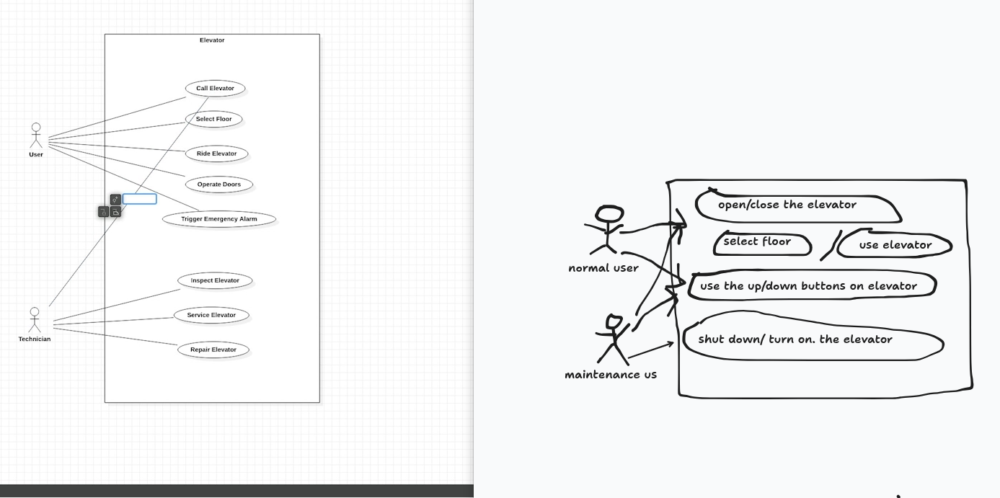

# Use Case Diagram
## purpose visualize the functional requirements of the system. (shows groups of related cases)
## make a diagram Use case
- draw oval in the middle with title of the use case in it. 
- stick figures to represent Actors. PRIMARY actors on left. secondary ones on the right of the Use case diagrams
- draw a fram around all use cases and actors that belong to agiven system
- use case descriptions neede (wakha we use Use case Diagram)

MY TRY VS THE COURSE DIAGRAM SOLUTION 
